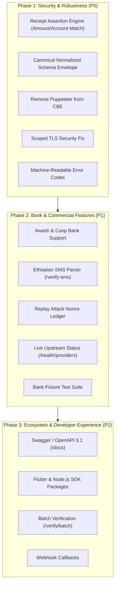

# 🔍 Senay Verifier — Architectural Review & Production Gap Analysis

> **Target Version**: `v3.2.0+`  
> **Repository**: [eyuelkebede20/verifier](https://github.com/eyuelkebede20/verifier)  
> **Environment**: cPanel / CloudLinux LVE (`verifier.senaycreatives.com`)  
> **Reviewed By**: Antigravity Engineering Review

---

## Executive Summary

**Senay Verifier** is a high-speed, zero-database microservice built to verify Ethiopian bank and mobile money receipts across 6 financial institutions (**Telebirr, CBE, Dashen, Bank of Abyssinia, CBE Birr, and Safaricom M-Pesa**).

The current version (`v3.1.0`) excels in its **lean memory footprint (~25MB RAM)**, **in-browser Telebirr client-bounce architecture** that bypasses foreign datacenter geo-blocks, and **sub-millisecond LRU caching**.

However, to transition from a **functional scraping utility** to a **bulletproof commercial payment verification platform** trusted by merchants, billing engines (MentalWeg), and e-commerce stores, several critical security, schema, resilience, and ecosystem gaps must be addressed.

---

## Current Architecture Strengths

Before reviewing what is missing, these established architectural invariants must be preserved:

- **Zero Database Runtime**: No external database processes (Postgres, Redis, MySQL, SQLite) to maintain, preventing deadlocks and memory exhaustion on CloudLinux shared hosting.
- **Client Bounce Protocol**: In-browser and mobile client bounce allows Ethiopian consumer IPs to fetch receipts blocked outside Ethiopia and return the raw markup to the backend.
- **Persistent HTTP/HTTPS Socket Pooling**: Connection reuse slashes 300–600ms of TCP/TLS handshakes per bank query.
- **In-Memory LRU Cache**: Fast-path cache returns duplicate queries in `< 1ms` with bounded memory.
- **Zero Heavy Native Dependencies**: Lightweight pure-JS PDF parsing and Cheerio DOM extraction.

---

## Priority Matrix Overview

| Priority | Category | Key Initiative | Impact | Effort |
| :--- | :--- | :--- | :--- | :--- |
| **P0 (Critical)** | **Security & Fraud** | Receipt Amount & Merchant Account Assertion | 🔴 Critical | Low |
| **P0 (Critical)** | **API Contract** | Canonical Normalized Receipt Schema | 🔴 Critical | Medium |
| **P0 (Critical)** | **Hosting Stability** | Remove Puppeteer Fallback in CBE Scraper | 🔴 Critical | Low |
| **P0 (Critical)** | **Security** | Scoped TLS Validation (`rejectUnauthorized: false`) | 🔴 Critical | Low |
| **P0 (Critical)** | **API Design** | Standardized Machine-Readable Error Codes | 🔴 Critical | Low |
| **P1 (High)** | **Fraud Prevention** | Replay Attack Mitigation & First-Seen Audit | 🟠 High | Medium |
| **P1 (High)** | **Fintech Coverage** | Awash Bank & Cooperative Bank of Oromia | 🟠 High | Medium |
| **P1 (High)** | **Fintech Coverage** | Ethiopian Bank SMS Notification Parser (`/verify-sms`) | 🟠 High | Medium |
| **P1 (High)** | **Reliability** | Upstream Bank Health Probe Endpoint (`/health/providers`) | 🟠 High | Low |
| **P1 (High)** | **Quality Assurance** | Bank Fixture Test Suite (Mock Receipts) | 🟠 High | Medium |
| **P2 (Medium)** | **Developer Experience**| Interactive OpenAPI 3.1 / Swagger Spec (`/docs`) | 🟡 Medium | Medium |
| **P2 (Medium)** | **Developer Experience**| Client SDKs (Flutter / Dart, TypeScript, Python) | 🟡 Medium | High |
| **P2 (Medium)** | **Performance** | Idempotency Keys & Batch Verification (`/verify/batch`) | 🟡 Medium | Medium |
| **P2 (Medium)** | **Architecture** | Webhook Callbacks for Asynchronous Verification | 🟡 Medium | Medium |
| **P3 (Nice-to-Have)**| **Observability** | Outage Telegram Alerts & p95 Latency Monitoring | 🟢 Low | Low |

---

## 1. P0: Critical Gaps (Must Have for Real-World Commercial Production)

### 1.1 Receipt Assertion & Fraud Prevention (Amount & Merchant Account Matching)
* **The Problem**:  
  Currently, `/verify` and bank endpoints only take a `reference` (plus optional `suffix` / `phoneNumber`) and return `success: true` if *any* legitimate transaction exists on the bank ledger.  
  *Vulnerability*: A malicious user buying a 10,000 ETB laptop can submit a legitimate 25 ETB receipt paid to their friend or an electric utility bill. The verifier will return `success: true`, and a naive merchant integration will fulfill the order.
* **What's Missing**:  
  Server-side **assertion parameters**:
  ```json
  POST /verify
  {
    "reference": "FT240101ABCD",
    "expectedAmount": 1000.00,
    "expectedReceiverAccount": "100012345678",
    "expectedCurrency": "ETB",
    "toleranceSeconds": 86400
  }
  ```
  If the receipt is valid but the amount is 950 ETB, or the recipient account is different, the verifier must immediately reject it with:
  ```json
  {
    "success": false,
    "code": "ASSERTION_FAILED",
    "error": "Receipt amount mismatch. Expected: 1000.00 ETB, Received: 950.00 ETB."
  }
  ```

---

### 1.2 Canonical Normalized Receipt Schema
* **The Problem**:  
  Every endpoint currently returns a completely different JSON structure:
  - `/verify-cbe`: `{ success: true, payer, receiver, amount, reference, date }`
  - `/verify-dashen`: `{ success: true, senderName, receiverName, transactionAmount, narrative }`
  - `/verify-cbebirr`: `{ success: true, data: { customerName, paidAmount, ... } }`
  - `/verify-telebirr`: `{ success: true, data: { payerName, settledAmount, serviceFee, ... } }`
  - `/api/public-verify`: `{ success: true, receipt: { payerName, receiverName, amount, ... }, raw: ... }`

  Developers integrating multiple banks must write custom branching parsers for every provider.
* **What's Missing**:  
  A **Single Universal Envelope** returned by all endpoints:
  ```json
  {
    "success": true,
    "provider": "TELEBIRR",
    "receipt": {
      "reference": "TB2601019999",
      "status": "COMPLETED",
      "amount": 500.00,
      "fee": 0.00,
      "currency": "ETB",
      "timestamp": "2026-11-04T06:12:00.000Z",
      "payer": {
        "name": "Abebe Kebede",
        "account": null,
        "phone": "0911223344"
      },
      "receiver": {
        "name": "Senay Creatives Demo Merchant",
        "account": "100012345678",
        "phone": "0922334455"
      },
      "reason": "Order #5021 payment"
    },
    "raw": { /* Full provider-native payload */ }
  }
  ```

---

### 1.3 Eliminating Puppeteer in `verifyCBE.ts`
* **The Problem**:  
  In [`src/services/verifyCBE.ts`](src/services/verifyCBE.ts), lines 78–129 contain a fallback that dynamically imports `puppeteer` and calls `puppeteer.launch({ headless: true, ... })`.
* **Why This is Dangerous**:  
  CloudLinux LVE shared hosting enforces a strict **4GB virtual memory address space limit**. Chromium requires at least 150–300MB RAM and triggers massive V8 allocations, causing `RangeError: WebAssembly.instantiate(): Out of memory` or freezing the entire Passenger worker pool.
* **What's Missing**:  
  1. Remove `puppeteer` from `package.json` completely (saves ~300MB bundle size).
  2. Replace legacy CBE fallback with an optimized direct HTTP/2 request or an external serverless scraper relay if direct fetch fails.

---

### 1.4 Scoped TLS Validation (Fixing Global `rejectUnauthorized: false`)
* **The Problem**:  
  In [`src/utils/httpClient.ts`](src/utils/httpClient.ts#L24), `sharedHttpsAgent` sets:
  ```typescript
  rejectUnauthorized: false
  ```
  This applies to **all** outbound network calls across all banks. It allows potential Man-In-The-Middle (MITM) attacks where an attacker on an intermediate network could forge responses from `mb.cbe.com.et`, `dashensuperapp.com`, or `safaricom.et`.
* **What's Missing**:  
  Keep TLS verification enabled by default (`rejectUnauthorized: true`), and only create a specialized bypass agent for specific legacy domains with known expired certificates (e.g., `apps.cbe.com.et:100`).

---

### 1.5 Standardized Machine-Readable Error Codes
* **The Problem**:  
  Errors are currently returned as arbitrary human-readable strings:
  `"Could not parse valid Telebirr receipt from provided HTML."` or `"Missing reference."`
* **What's Missing**:  
  A structured `code` property on all error responses:
  - `INVALID_PAYLOAD`: Missing or malformed parameters.
  - `PROVIDER_UNAVAILABLE`: Upstream bank portal is timing out or returning 5xx.
  - `RECEIPT_NOT_FOUND`: Upstream returned 404; transaction does not exist.
  - `ASSERTION_FAILED`: Amount or recipient account does not match expected values.
  - `RATE_LIMITED`: Client exceeded sliding-window rate limit.
  - `PARSE_ERROR`: Bank HTML/PDF changed format and could not be extracted.

---

## 2. P1: Major Enhancements (Fintech & Merchant Scale)

### 2.1 Replay Attack Mitigation (Deduplication Nonce)
* **The Problem**:  
  Once a customer has a valid receipt, they could submit the same reference code across multiple distinct orders or accounts.
* **What's Missing**:  
  Even without an external database, the verifier can maintain an append-only transaction hash index or support an `orderId` binding:
  - If a receipt reference has already been verified for `order_1001`, a subsequent verification request with `order_1002` receives a warning:
    ```json
    {
      "success": true,
      "warning": "POTENTIAL_REPLAY",
      "firstVerifiedAt": "2026-11-04T05:20:00.000Z",
      "previouslyBoundTo": "order_1001"
    }
    ```

---

### 2.2 Expanding Bank Coverage (Awash Bank & Coop Bank)
* **The Problem**:  
  The current 6 providers cover CBE, Telebirr, Dashen, BoA, CBE Birr, and M-Pesa. However, two of Ethiopia's highest-volume private payment rails are missing:
  1. **Awash Bank (Awash Birr / Internet Banking)**: Largest private bank in Ethiopia, heavy merchant adoption.
  2. **Cooperative Bank of Oromia (Coopay-Ebirr)**: Extremely popular in regional trade, agriculture, and retail.
* **What's Missing**:  
  - `src/services/verifyAwash.ts`
  - `src/services/verifyCoop.ts`
  - Auto-routing integration in `src/services/verifyUniversal.ts`.

---

### 2.3 Ethiopian Bank SMS Notification Parser (`POST /verify-sms`)
* **The Opportunity**:  
  In Ethiopia, over 70% of small businesses, retail shops, and Telegram bots rely on SMS notifications pushed to the merchant's phone:
  - CBE: `"Dear Customer, your A/C 1000****5678 has been credited with ETB 1,500.00 from Abebe Kebede on 04/11/2026. Ref: FT240101ABCD"`
  - Telebirr: `"You have received 500.00 ETB from 0911****44 (Abebe Kebede). Transaction number: TB2601019999."`
* **What's Missing**:  
  A dedicated endpoint `POST /verify-sms`:
  ```json
  POST /verify-sms
  {
    "sender": "CBE",
    "message": "Dear Customer, your A/C 1000****5678 has been credited with ETB 1,500.00 from Abebe Kebede on 04/11/2026. Ref: FT240101ABCD",
    "crossVerify": true
  }
  ```
  1. Validates SMS sender header format (`CBE`, `telebirr`, `BoA`).
  2. Parses out amount, payer name, timestamp, and reference via regex.
  3. If `crossVerify: true`, automatically runs the extracted reference through the authoritative bank verifier to ensure the SMS wasn't spoofed.

---

### 2.4 Upstream Bank Health Probe (`GET /health/providers`)
* **The Problem**:  
  `src/services/statusProbeService.ts` contains probe logic, but the public `/health` endpoint only reports Node process uptime.
* **What's Missing**:  
  Expose a live provider status endpoint:
  ```json
  GET /health/providers
  {
    "status": "operational",
    "providers": {
      "telebirr": { "status": "UP", "latencyMs": 420, "mode": "client_bounce_recommended" },
      "cbe": { "status": "UP", "latencyMs": 850 },
      "dashen": { "status": "UP", "latencyMs": 1100 },
      "abyssinia": { "status": "UP", "latencyMs": 350 },
      "cbebirr": { "status": "UP", "latencyMs": 1400 },
      "mpesa": { "status": "DEGRADED", "latencyMs": 3200 }
    }
  }
  ```
  This allows merchants to display real-time notices to customers (e.g. *"CBE Birr is experiencing bank downtime; please pay with Telebirr or CBE"*).

---

### 2.5 End-to-End Bank Fixture Test Suite (Offline VCR Tests)
* **The Problem**:  
  Currently, unit tests only test mock references (`TEST...`) and cache keys. There are **zero tests** verifying that `scrapeTelebirrReceipt`, `parseDashenReceipt`, or `parseCBEReceipt` correctly extract data from real-world bank HTML and PDF files.
* **What's Missing**:  
  A `src/tests/fixtures/` directory containing:
  - Saved Telebirr HTML samples (standard payment, bank transfer, VAT receipt, service fee variation)
  - Saved Dashen Bank PDF receipts
  - Saved CBE Mobile JSON responses
  - Saved CBE Birr PDF receipts
  Regression tests verifying that regex updates do not break field extraction.

---

## 3. P2: Developer Experience & Integration Ecosystem

### 3.1 OpenAPI 3.1 Specification & Swagger UI (`/docs`)
* **What's Missing**:  
  Replace the plain-text JSON returned at `/api` with a comprehensive OpenAPI 3.1 specification (`/openapi.json`) and an interactive Swagger UI or Scalar documentation interface (`/docs`).
* **Value**:  
  Developers can import the spec directly into Postman, Insomnia, or run `openapi-typescript` / `openapispect` to generate types instantly.

---

### 3.2 Official Client SDKs
* **What's Missing**:  
  To drive adoption across the Ethiopian developer ecosystem, release lightweight client libraries:
  1. **Flutter / Dart** (`senay_verifier` on pub.dev): Built-in camera QR scanner, Google ML Kit on-device reference extraction, and automated Telebirr client-bounce HTTP call.
  2. **TypeScript / Node.js** (`npm i senay-verifier`): Typed Axios wrapper with automatic retry and assertion helpers.
  3. **Python** (`pip install senay-verifier`): For Django, FastAPI, and Flask e-commerce backends.

---

### 3.3 Batch Verification Endpoint (`POST /verify/batch`)
* **What's Missing**:  
  A dedicated endpoint to verify up to 50 receipts in a single HTTP request for nightly accounting reconciliation:
  ```json
  POST /verify/batch
  {
    "items": [
      { "id": "req_1", "reference": "FT240101ABCD" },
      { "id": "req_2", "reference": "TB2601019999", "html": "..." }
    ],
    "concurrency": 3
  }
  ```

---

### 3.4 Webhook Callbacks for Asynchronous Verification
* **What's Missing**:  
  Some bank queries (especially legacy PDF endpoints or congested servers) can take 5–15 seconds. For background workers or asynchronous checkouts, accept a `webhookUrl`:
  ```json
  POST /verify
  {
    "reference": "FT240101ABCD",
    "webhookUrl": "https://myapp.com/api/webhooks/payment-verifier"
  }
  ```
  The verifier acknowledges immediately with `202 Accepted` and posts the verified receipt payload to the webhook when complete.

---

## 4. P3: Operational Polish & Monitoring

### 4.1 Automated Outage Alerts (Telegram Bot)
* **What's Missing**:  
  When an upstream bank changes its HTML markup or API headers (causing 3 consecutive parsing failures), trigger an immediate alert to a Telegram channel:
  ```
  🚨 Verifier Alert: Telebirr parsing failure rate > 50% in last 5 minutes.
  Potential bank markup update detected.
  ```

### 4.2 Latency Percentile Monitoring (p50, p95, p99)
* **What's Missing**:  
  Enhance `usageTrackerService` to record latency percentiles per provider. Display p50 and p95 latency graphs on the `/admin` dashboard.

### 4.3 HTTP Response Compression
* **What's Missing**:  
  Install `compression` middleware in Express to gzip/brotli large landing page assets, OCR scripts, and verbose API JSON responses.

---

## 5. Recommended Implementation Roadmap



---

## 6. Summary of Action Items

1. **Deploy Assertion Logic**: Add `expectedAmount` and `expectedReceiverAccount` checks to prevent the #1 financial fraud vector in receipt verification.
2. **Standardize JSON Output**: Unify all endpoints to return `{ success, provider, receipt, raw }` so frontend and mobile developers write clean, provider-agnostic code.
3. **Purge Puppeteer**: Delete Puppeteer to protect CloudLinux memory and guarantee 100% uptime within the 25MB RAM budget.
4. **Build Offline Fixture Tests**: Add real receipt HTML and PDF samples into `src/tests/fixtures` to guard against regex regressions.
5. **Add Awash & SMS Verification**: Expand market coverage to capture 95%+ of all digital transactions in Ethiopia.
